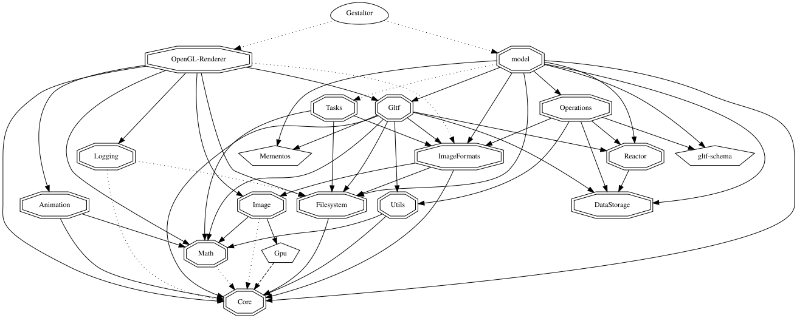

### **Gestaltor**

A visual editor made by **UX3D** for the **Khronos glTF Format**

<br/>

# Status

[](https://github.com/ux3d/Gestaltor/actions/workflows/CI.yml)

# Requirements

- CMake
- C++ Compiler
- Python 3
- Conan (`pip install conan`)
- [Dart SDK](https://dart.dev/get-dart): To build gltf-validator on macOS Intel, download it manually instead of using brew. 

# Building 

## Linux

Install dependencies as listed in [.github/workflows/CI.yml](.github/workflows/CI.yml)

```sh
# This might be incomplete, always check with the CI workflow to be sure to include all dependencies
sudo apt-get install -y ninja-build libgl1-mesa-dev libxkbcommon-x11-dev "libxcb-*"
wget http://security.ubuntu.com/ubuntu/pool/main/i/icu/libicu60_60.2-3ubuntu3.2_amd64.deb
sudo apt-get install ./libicu60_60.2-3ubuntu3.2_amd64.deb
sudo apt-get install ccache
sudo apt-get install fontconfig libsm6 fuse file

```

## Windows
### Extra Requirements
- Visual Studio 2019 Build Tools with C++ Desktop Development and CMake tools for Windows installed
- [CMake](https://cmake.org/download/) installed and added to PATH
- [Perl](https://strawberryperl.com/) installed and added to PATH

To build simply run the following commands in a terminal:

```sh
:: Call CMake to configure the build (generates the build scripts)
cmake  -S%SrcDir% -B%BuildDir% -DCMAKE_BUILD_TYPE:STRING=Debug -DCMAKE_EXPORT_COMPILE_COMMANDS:BOOL=TRUE -DCMAKE_RUNTIME_OUTPUT_DIRECTORY:STRING=%ExeFileDir% -G "Ninja"


:: Call CMake again to build the project
cmake --build %BuildDir% --config Debug --target Gestaltor -v
```

SrcDir refers to the base directory.

BuildDir refers to the build directory (i.e. root/build/).

ExeFileDir refers to %BuildDir%\bin\Debug


# Architecture

## Current Dependency Graph

Gestaltor currently has a complex network of dependencies that you can understand from the following figure. Note that this graph is automatically updated as dependencies change in Gestaltor. [Legend for node shapes and edges](documentation/dependencies/dependencies.dot.svg)


