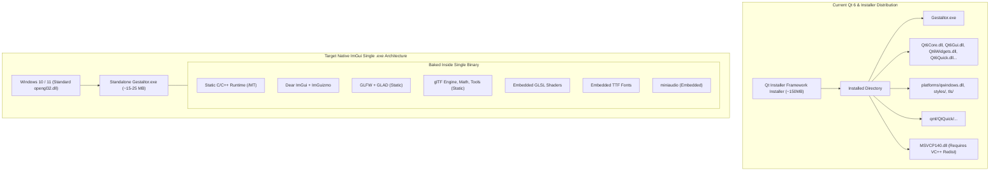

# Migration Plan: Transitioning Gestaltor from Qt 6 to Native Dear ImGui & Single Standalone Executable Distribution

## 1. Executive Summary & Objective

**Gestaltor** is currently built as a hybrid **Qt 6 (Widgets + QML/Quick)** application distributed via **Qt Installer Framework** installers. While the user interface and installer layers are bound to Qt, the core systems are already **100% Qt-free**:
- **3D Renderer** (`OpenGL-Renderer/renderer`): Uses an abstract C++ interface `gl::GL` (`OpenGL-Renderer/renderer/include/renderer/gl/GL.h`).
- **glTF Data Model & State Machine** (`editor/model`): Built purely on `nlohmann::json`, `RxCpp` observables, and mementos.
- **Tools & Operations** (`OpenGL-Renderer/Tools/tools`): Pure C++20 for mesh processing, image formats, and file operations.
- **Headless Automation** (`automated/python`): C++ wrapped with `pybind11`.

### Primary Goals:
1. **Replace UI Framework**: Completely eliminate Qt 6 and replace it with a native, ultra-lightweight **Dear ImGui (Docking branch) + GLFW + GLAD** stack.
2. **Retire All Installers**: Completely remove the Qt Installer Framework (`Deployment/packages/`, `Deployment/deploy_windows.py`, `qtinstallerframework`).
3. **True Single `.exe` Distribution**: Produce a **100% portable, standalone `Gestaltor.exe`** with zero external DLLs, no installers, no VC++ Redistributable requirement, and no loose resource folders required at runtime.

### Key Benefits:
* **Zero Installer / Single `.exe`**: Double-click `Gestaltor.exe` directly; no extraction or installation steps.
* **Distribution Size**: Drops from **~250MB+ (with Qt DLLs, plugins, and QML assets)** down to **~15MB – 25MB standalone binary**.
* **Zero Runtime Dependencies**: MSVC runtime compiled with `/MT` (no "VC++ Redistributable missing" errors).
* **Licensing**: 100% permissive (MIT, Apache 2.0, zlib, Public Domain) with zero LGPLv3 dynamic relinking overhead.
* **Build Speed**: Eliminates 12+ Conan Qt packages and code generators; clean build time drops from **5–10 minutes** to **~30 seconds**.

---

## 2. Target Technology Stack

| Component | Current Stack | Target ImGui / Standalone Stack | Source / Integration |
| :--- | :--- | :--- | :--- |
| **Distribution / Packaging** | Qt Installer Framework (`.exe` installer) | **True Standalone `.exe`** (Zero DLLs) | Native CMake build |
| **C/C++ Runtime** | Dynamic CRT (`/MD`) | **Static CRT (`/MT`)** | `CMAKE_MSVC_RUNTIME_LIBRARY` |
| **Windowing & OS Events** | `QApplication`, `QMainWindow` | **GLFW 3.3+** (Static `.lib`) | CMake `FetchContent` |
| **OpenGL Function Loader** | `QOpenGLFunctions_4_1_Core` (`QtGL.h`) | **GLAD** (OpenGL 4.1 Core profile) | Generated / `FetchContent` |
| **UI Framework** | Qt Widgets + QML (Qt Quick) | **Dear ImGui (`docking` branch)** | CMake `FetchContent` |
| **3D Transform Gizmos** | Custom Qt Gizmo & input events | **ImGuizmo** | CMake `FetchContent` |
| **Native File Dialogs** | `QFileDialog` | **portable-file-dialogs (pfd)** | Header-only (MIT) |
| **Filesystem Operations** | `QtFileSystem` | Standard **`std::filesystem`** (C++20) | Standard Library |
| **Settings Storage** | `QSettings` | JSON via **`nlohmann::json`** | Already integrated |
| **Shaders & Assets** | Loose files / `.qrc` files via `rcc` | **Embedded Byte Arrays** (`const uint8_t[]`) | CMake header generator / C++20 |
| **Spatial Audio** | OpenAL Soft (LGPL `.dll`) | **miniaudio** (MIT/Public Domain) | Single header-only |
| **Image Loading/Previews**| `QImage` | **stb_image / stb_image_write** | Already integrated |

---

## 3. High-Level Architecture Comparison



---

## 4. Single `.exe` Distribution Architecture

To ship a single `.exe` with zero dependencies, the following four engineering mechanisms are implemented:

### A. Static C/C++ Runtime (`/MT`)
By default, MSVC links the dynamic C/C++ runtime (`/MD`), which crashes with a "VCRUNTIME140.dll is missing" error on computers without the Visual C++ Redistributable.
* Configure CMake to enforce static runtime across all configurations:
  ```cmake
  set(CMAKE_MSVC_RUNTIME_LIBRARY "MultiThreaded$<$<CONFIG:Debug>:Debug>")
  ```

### B. Static Linking of All Libraries
Ensure every dependency is built as a static archive (`.lib`) linked directly into the executable:
* `set(BUILD_SHARED_LIBS OFF CACHE BOOL "" FORCE)`
* `set(GLFW_BUILD_SHARED_LIBS OFF CACHE BOOL "" FORCE)`
* Build `assimp`, `draco`, `ktx`, `libwebp`, and `oneTBB` with static linkage.

### C. In-Memory Asset & Shader Embedding
Currently, shaders and styles are bundled using Qt's `rcc` resource compiler into `.qrc` files. In the ImGui build:
1. **GLSL Shaders**:
   * A lightweight CMake build step converts `.vert`, `.frag`, and `.comp` files into C++ header files (`#include "shaders/PbrShader.h"`) containing `const char*` or `const uint8_t[]` byte arrays.
   * Shaders are loaded directly from memory via `glShaderSource`.
2. **Fonts**:
   * The UI font (e.g., Roboto or Inter) is embedded as a `const uint8_t font_data[]` array.
   * Loaded at runtime using ImGui's memory font loader:
     ```cpp
     ImFont* font = io.Fonts->AddFontFromMemoryTTF(embedded_font_data, sizeof(embedded_font_data), 16.0f);
     ```
3. **Application Icons**:
   * Windows executable icon is embedded via standard Windows resource file (`resources/Icon_Application.rc`).

### D. Audio Simplification (Eliminating `OpenAL32.dll` and LGPL)
* The current audio module links `OpenAL Soft` (LGPL), which typically requires distributing `OpenAL32.dll`.
* Replace the low-level backend in `OpenGL-Renderer/Tools/Runtime/runtime/audio/` with **[miniaudio](https://github.com/mackron/miniaudio)** (a single, header-only C library with zero external dependencies, under MIT/Public Domain).
* **Result**: Zero audio DLLs to distribute, and complete freedom from LGPL constraints.

---

## 5. Codebase Inventory & Impact Analysis

### A. Subsystems Untouched (100% Reused)
* `OpenGL-Renderer/renderer/`: All glTF shaders, render passes, PBR pipeline, command generator, and resource manager.
* `OpenGL-Renderer/Tools/tools/`: All glTF serialization, mesh utilities, imageformats, datastorage, reactor, mementos.
* `OpenGL-Renderer/Tools/Runtime/`: Math, Image, Core dispatch queue.
* `editor/model/`: `GltfModel`, `EditorModel`, `ProjectManager`, tasks.
* `subprocess/`: Process builder.

### B. Subsystems To Be Retired
* **All Installers**:
  * `Deployment/packages/ux3d.gestaltor/`
  * `Deployment/deploy_windows.py`
  * `Deployment/helpers/` (Qt-specific deploy scripts)
  * `resources/config.xml.in`
  * Conan `qtinstallerframework` dependency
* **Qt UI**:
  * `ui/`: All Qt Designer `.ui` files.
  * `editor/qml/`: All QML files and JavaScript helpers.
  * `editor/js/`: Rollup, TypeScript, and NPM bundling tools (`package.json`, `rollup.config.js`).
  * `source/promoters/` and `header/promoters/`: All custom promoted Qt widgets.
  * `source/widgets/HotReload*`: QML dynamic reloading widgets.
  * `header/widgets/renderContext/QtGL.h` & `source/widgets/renderContext/QtGL.cpp`: Qt OpenGL abstraction.

### C. Subsystems To Be Created
* `source/imgui/`:
  * `ImGuiContextManager.h / .cpp`: ImGui initialization, docking configuration, custom dark styling/theme.
  * `GladGL.h / .cpp`: Complete implementation of `ux3d::renderer::gl::GL` via GLAD.
  * `ViewportPanel.h / .cpp`: FBO rendering, ImGuizmo integration, mouse/keyboard camera navigation.
  * `HierarchyPanel.h / .cpp`: Tree view of scenes, nodes, drag-and-drop reparenting, visibility toggles.
  * `InspectorPanel.h / .cpp`: Transform, PBR material, texture slots, camera, and mesh editing.
  * `AnimationPanel.h / .cpp`: Play/pause, scrubbing bar, clip selector.
  * `LoggerPanel.h / .cpp`: Log stream window with filtering.
  * `StatisticsPanel.h / .cpp`: Geometry and texture memory inspection.
  * `MenuBar.h / .cpp`: File (Open, Save, Export), Edit (Undo, Redo), View, Help menus.
  * `AssetEmbedder.h`: Embedded font and shader byte arrays.

---

## 6. Step-by-Step Implementation Roadmap


---

### Phase 1: Dual-Target CMake Setup & Dependencies

> **Note**: Do NOT delete Qt code in Phase 1. Create a parallel CMake target `Gestaltor-ImGui` so the project can be built, tested, and validated side-by-side without breaking the existing application.

#### Tasks:
1. **Configure Static Runtime**:
   ```cmake
   set(CMAKE_MSVC_RUNTIME_LIBRARY "MultiThreaded$<$<CONFIG:Debug>:Debug>")
   ```
2. **Add ImGui & GLFW to CMake**:
   Use `FetchContent` in a new file `cmake/imgui_dependencies.cmake`:
   ```cmake
   include(FetchContent)

   # GLFW
   FetchContent_Declare(
       glfw
       GIT_REPOSITORY https://github.com/glfw/glfw.git
       GIT_TAG 3.3.8
   )
   set(GLFW_BUILD_DOCS OFF CACHE BOOL "" FORCE)
   set(GLFW_BUILD_TESTS OFF CACHE BOOL "" FORCE)
   set(GLFW_BUILD_EXAMPLES OFF CACHE BOOL "" FORCE)
   set(GLFW_BUILD_SHARED_LIBS OFF CACHE BOOL "" FORCE)
   FetchContent_MakeAvailable(glfw)

   # Dear ImGui (docking branch)
   FetchContent_Declare(
       imgui
       GIT_REPOSITORY https://github.com/ocornut/imgui.git
       GIT_TAG docking
   )
   FetchContent_MakeAvailable(imgui)

   # ImGuizmo
   FetchContent_Declare(
       imguizmo
       GIT_REPOSITORY https://github.com/CedricGuillemet/ImGuizmo.git
       GIT_TAG master
   )
   FetchContent_MakeAvailable(imguizmo)

   # Portable File Dialogs
   FetchContent_Declare(
       pfd
       GIT_REPOSITORY https://github.com/samhocevar/portable-file-dialogs.git
       GIT_TAG master
   )
   FetchContent_MakeAvailable(pfd)
   ```
3. **Setup GLAD**:
   Generate or fetch GLAD for OpenGL 4.1 Core profile.
4. **Declare Target**:
   Add `add_executable(Gestaltor-ImGui ...)` in `CMakeLists.txt` linking `model`, `OpenGL-Renderer`, `glfw`, `imgui`, `glad`.

---

### Phase 2: OpenGL Abstraction Bridge (`GladGL`)

Implement the `ux3d::renderer::gl::GL` interface using raw OpenGL 4.1 function pointers.

#### Interface Implementation:
Create `header/imgui/GladGL.h` and `source/imgui/GladGL.cpp`:
```cpp
#pragma once
#include "renderer/gl/GL.h"
#include <glad/glad.h>
#include <unordered_set>
#include <optional>
#include <string>

namespace ux3d::renderer {
class GladGL : public gl::GL {
public:
    GladGL() = default;
    virtual ~GladGL() override = default;

    virtual bool hasExtension(const GLchar* extensionName) override;
    virtual GLenum getError() override { return glGetError(); }
    virtual void getIntegerv(GLenum pname, GLint* data) override { glGetIntegerv(pname, data); }
    virtual void getFloatv(GLenum pname, GLfloat* param) override { glGetFloatv(pname, param); }
    virtual const GLubyte* getString(GLenum name) override { return glGetString(name); }
    virtual const GLubyte* getStringi(GLenum name, GLuint index) override { return glGetStringi(name, index); }
    virtual void enable(GLenum cap) override { glEnable(cap); }
    virtual void disable(GLenum cap) override { glDisable(cap); }
    virtual void finish() override { glFinish(); }
    
    // Shaders
    virtual GLuint createShader(GLenum type) override { return glCreateShader(type); }
    virtual void deleteShader(GLuint shader) override { glDeleteShader(shader); }
    virtual void shaderSource(GLuint s, GLsizei c, const GLchar** str, const GLint* len) override { glShaderSource(s, c, str, len); }
    virtual void compileShader(GLuint shader) override { glCompileShader(shader); }
    virtual void getShaderiv(GLuint shader, GLenum pname, GLint* params) override { glGetShaderiv(shader, pname, params); }
    virtual void getShaderInfoLog(GLuint s, GLsizei m, GLsizei* l, GLchar* log) override { glGetShaderInfoLog(s, m, l, log); }

    // Buffers & Pipeline State
    virtual void viewport(GLint x, GLint y, GLsizei w, GLsizei h) override { glViewport(x, y, w, h); }
    virtual void drawArrays(GLenum mode, GLint first, GLsizei count) override { glDrawArrays(mode, first, count); }
    virtual void drawElements(GLenum mode, GLsizei count, GLenum type, const void* indices) override { glDrawElements(mode, count, type, indices); }

    // ... [All remaining methods from gl::GL implemented directly via glad_gl*]
};
}
```
* **Milestone**: Write a minimalist GLFW window running `GladGL` that successfully calls `renderer->init()` and clears the background color.

---

### Phase 3: FBO Viewport, ImGuizmo & Camera Controls

Host the 3D viewport inside an ImGui dockable window.

1. **Viewport Framebuffer**:
   * Create an FBO with a color texture attachment (`GL_RGBA8` or `GL_RGBA16F`) and a depth/stencil renderbuffer (`GL_DEPTH24_STENCIL8`).
   * When the ImGui Viewport panel resizes, reallocate FBO textures if size changes:
     ```cpp
     ImVec2 viewportPanelSize = ImGui::GetContentRegionAvail();
     if (viewportPanelSize.x != currentWidth || viewportPanelSize.y != currentHeight) {
         resizeFBO((int)viewportPanelSize.x, (int)viewportPanelSize.y);
     }
     ```
2. **Rendering to Texture**:
   * Bind FBO.
   * Invoke `renderer::Renderer::render()`.
   * Unbind FBO.
3. **Display in ImGui**:
   ```cpp
   ImGui::Begin("3D Viewport");
   ImVec2 pos = ImGui::GetCursorScreenPos();
   ImGui::Image((ImTextureID)(intptr_t)colorTextureId, viewportPanelSize, ImVec2(0, 1), ImVec2(1, 0));
   ```
4. **Input Handling**:
   * Forward mouse dragging (orbit, pan, zoom) to `CameraActor` only when `ImGui::IsItemHovered()` or `ImGui::IsWindowFocused()`.
5. **ImGuizmo Integration**:
   * Configure ImGuizmo rect to match the ImGui viewport position and size.
   * Pass View matrix, Projection matrix, and selected Node's model matrix to `ImGuizmo::Manipulate()`.
   * When modified, commit translation/rotation/scale back through `ux3d::model::GltfModel`.

---

### Phase 4: Scene Hierarchy Panel & Selection

Replace `hierarchy.qml` and `source/HierarchyModel.cpp` with an immediate-mode ImGui tree.

1. **Tree Hierarchy**:
   * Traverse glTF nodes starting from active `scene.nodes`:
     ```cpp
     void RenderNodeTree(int nodeIndex, GltfModel& model) {
         const auto& node = model.getNode(nodeIndex);
         ImGuiTreeNodeFlags flags = ImGuiTreeNodeFlags_OpenOnArrow | ImGuiTreeNodeFlags_SpanAvailWidth;
         if (model.isSelected(nodeIndex)) flags |= ImGuiTreeNodeFlags_Selected;
         if (node.children.empty()) flags |= ImGuiTreeNodeFlags_Leaf;

         bool open = ImGui::TreeNodeEx((void*)(intptr_t)nodeIndex, flags, "%s", node.name.c_str());
         if (ImGui::IsItemClicked()) {
             model.selectNode(nodeIndex);
         }
         // Drag and drop reparenting
         if (ImGui::BeginDragDropSource()) {
             ImGui::SetDragDropPayload("GLTF_NODE", &nodeIndex, sizeof(int));
             ImGui::Text("Move %s", node.name.c_str());
             ImGui::EndDragDropSource();
         }
         if (ImGui::BeginDragDropTarget()) {
             if (const ImGuiPayload* payload = ImGui::AcceptDragDropPayload("GLTF_NODE")) {
                 int draggedIndex = *(int*)payload->Data;
                 model.reparentNode(draggedIndex, nodeIndex);
             }
             ImGui::EndDragDropTarget();
         }
         if (open) {
             for (int childIndex : node.children) {
                 RenderNodeTree(childIndex, model);
             }
             ImGui::TreePop();
         }
     }
     ```
2. **Node Visibility & Renaming**:
   * Eye icon / checkbox to toggle node visibility.
   * Double-click on node label to rename directly with `ImGui::InputText`.

---

### Phase 5: Inspector Panel (Property Editing)

Replace `inspector.qml` and `source/InspectorModel.cpp`.

1. **Node Transform**:
   * Translation: `ImGui::DragFloat3("Position", &pos[0], 0.01f)`
   * Rotation (Euler or Quaternion): `ImGui::DragFloat3("Rotation", &rot[0], 0.1f)`
   * Scale: `ImGui::DragFloat3("Scale", &scale[0], 0.01f)`
2. **PBR Material Properties**:
   * Base Color: `ImGui::ColorEdit4("Base Color", &baseColor[0])`
   * Metallic: `ImGui::SliderFloat("Metallic", &metallic, 0.0f, 1.0f)`
   * Roughness: `ImGui::SliderFloat("Roughness", &roughness, 0.0f, 1.0f)`
   * Emissive: `ImGui::ColorEdit3("Emissive Color", &emissive[0])`
   * Alpha Mode dropdown (`OPAQUE`, `MASK`, `BLEND`).
   * Double Sided toggle.
3. **Texture Slots**:
   * Slot preview buttons showing thumbnail of assigned texture.
   * "Select Texture..." button opening OS file picker via `pfd::open_file`.
4. **glTF Extensions UI**:
   * Collapsible sections for `KHR_materials_unlit`, `KHR_materials_clearcoat`, `KHR_materials_transmission`, `KHR_materials_volume`, `KHR_materials_ior`, `KHR_texture_transform`.

---

### Phase 6: Menus, Timeline, miniaudio & Extras

1. **Top Menu Bar**:
   * `File`:
     * Open (`Ctrl+O`) $\rightarrow$ `pfd::open_file` $\rightarrow$ `model.loadFile()`
     * Save (`Ctrl+S`) $\rightarrow$ `model.saveFile()`
     * Save As (`Ctrl+Shift+S`) $\rightarrow$ `pfd::save_file`
     * Export USDZ $\rightarrow$ calls `USDZExportTask`
     * Exit
   * `Edit`:
     * Undo (`Ctrl+Z`) $\rightarrow$ `model.undo()`
     * Redo (`Ctrl+Y`) $\rightarrow$ `model.redo()`
   * `View`:
     * Toggle Viewport, Hierarchy, Inspector, Logger, Statistics panels.
2. **Animation Timeline Panel**:
   * Play/Pause buttons, current time display, timeline slider.
   * Dropdown to select active animation clip.
3. **Environment & Viewport Settings**:
   * Load HDR environment map (IBL).
   * Exposure slider, Tone mapping selector (ACES, Reinhard, Linear, Khronos PBR Neutral).
   * Grid toggle, Wireframe toggle.
4. **Log Console**:
   * Connect `core::Logger` output to an ImGui window with text filtering and log level tags (`[INFO]`, `[WARN]`, `[ERROR]`).
5. **Asset Statistics**:
   * Total triangle count, vertex count, mesh count, texture count, and estimated VRAM usage.
6. **Audio with miniaudio**:
   * Replace OpenAL backend with single-header `miniaudio.h`.

---

### Phase 7: Retiring Qt, Deleting Installers & Single `.exe` Finalization

Once `Gestaltor-ImGui` reaches feature parity with `Gestaltor`:

1. **Delete All Installer Files**:
   * Remove directory `Deployment/packages/`
   * Remove `Deployment/deploy_windows.py`
   * Remove `resources/config.xml.in`
   * Remove `qtinstallerframework` from Conan.
2. **Remove Qt from `CMakeLists.txt`**:
   * Remove `find_package(Qt6 ...)` calls.
   * Remove `CMAKE_AUTOMOC`, `CMAKE_AUTOUIC`, `CMAKE_AUTORCC`.
   * Remove all `.qrc` resource files.
   * Remove `windeployqt`, `macdeployqt`, and `BundleUtilities` calls.
3. **Remove Qt from Conan (`CMakeLists.txt`)**:
   * Delete `qt-conan-common`, `qtbase`, `qtdeclarative`, `qtsvg`, `qttools`, `qtstatemachine`, `qt5compat`, `qtshadertools`, `qtimageformats`, `qtactiveqt`.
   * Keep only non-Qt Conan packages: `openssl`, `assimp`, `draco`, `nlohmann_json`, `libwebp`, `json-schema-validator`, `ktx`, `minimp3`, `stb`, `fmt`.
4. **Delete Obsolete UI Files**:
   * Delete `ui/` directory.
   * Delete `editor/qml/` directory.
   * Delete `editor/js/` directory.
   * Delete `source/promoters/` and `header/promoters/`.
   * Delete `header/widgets/renderContext/QtGL.h` and `source/widgets/renderContext/QtGL.cpp`.
5. **Final Target Configuration**:
   * Set executable name: `Gestaltor` (outputs `Gestaltor.exe`).
   * Verify with Dependency Walker / Dependencies tool that `Gestaltor.exe` only imports standard OS DLLs (`kernel32.dll`, `user32.dll`, `gdi32.dll`, `opengl32.dll`, `shell32.dll`).

---

## 7. Verification Checklist for Subsequent Sessions

- [ ] **Phase 1 Complete**: `Gestaltor-ImGui` executable target compiles with GLFW, GLAD, and `/MT` static runtime.
- [ ] **Phase 2 Complete**: `GladGL` successfully passes all `gl::GL` calls; window clears and draws basic OpenGL shapes.
- [ ] **Phase 3 Complete**: Viewport renders loaded glTF scene to FBO; ImGuizmo manipulates camera and selected object.
- [ ] **Phase 4 Complete**: Node hierarchy renders in ImGui; selection synchronizes bidirectionally with the viewport.
- [ ] **Phase 5 Complete**: Transforms and PBR materials editable in Inspector; changes reflect live in the 3D viewport.
- [ ] **Phase 6 Complete**: File dialogs open/save models; animations play back smoothly on the timeline; miniaudio plays spatial audio.
- [ ] **Phase 7 Complete**:
  - [ ] All Qt packages removed from CMake and Conan.
  - [ ] All installer scripts and packages deleted (`Deployment/packages/`, `deploy_windows.py`).
  - [ ] Standalone `Gestaltor.exe` builds cleanly (~15MB–25MB).
  - [ ] Executable runs cleanly on a bare Windows system without external DLLs or installers.
