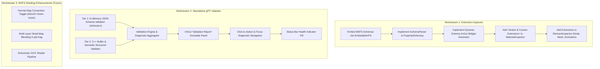

# MSFS glTF Extensions & Built-in Validator Work Journal

**Branch**: `msfs-gltf`  
**Status**: Planning & Architecture Phase (Execution Pending)  
**Target Application**: Gestaltor glTF Viewer (Standalone Dear ImGui + OpenGL 4.1)  

---

## 1. Executive Summary & Objectives

The goal of this initiative is to elevate Gestaltor into a premier visual inspector for **Microsoft Flight Simulator (MSFS 2020 / 2024)** glTF 2.0 / GLB assets without sacrificing the core project tenet: **100% Standalone Single Executable with Zero External Dependencies**.

### Primary Objectives:
1. **Schema-Driven Custom Extension Inspector**:
   Expose all MSFS-specific vendor extensions (`ASOBO_*`) directly in the UI with typed, documented ImGui controls derived from the MSFS 2024 SDK JSON Schemas. This spans Materials, Meshes, Primitives, Nodes, and Animations.
2. **Built-in glTF Validator (Native C++)**:
   Replace the legacy external `gltf_validator.exe` subprocess dependency with a 100% in-process C++ validation engine combining **In-Memory JSON Schema validation** (`nlohmann_json_schema_validator`) and **C++ Semantic Buffer validation**, surfaced via an interactive ImGui panel.
3. **Targeted MSFS Shader Enhancements (Future Rendering Roadmap)**:
   Progressively implement the most critical MSFS shading conventions in OpenGL GLSL (such as DirectX vs. OpenGL normal map inversion and multi-layer detail map blending).

---

## 2. Current State Assessment

### 2.1 File Ingestion & Preservation
* **Status**: **Fully Functional**.
* When Gestaltor opens an MSFS glTF/GLB file, the parser ([`GltfObjectFromJson.cpp`](file:///H:/git-repos/gltf-viewer/OpenGL-Renderer/Tools/tools/gltf/source/json/GltfObjectFromJson.cpp#L19-L31)) iterates through `"extensions"`.
* Any extension not recognized as a standard Khronos extension (`KHR_materials_*`, `KHR_lights_punctual`, etc.) is added to `GltfObject::m_unknownExtensions` as a serialized JSON string.
* Because every core glTF class (`Material`, `Node`, `Mesh`, `Primitive`, `Animation`, `AnimationChannel`, `Camera`, `Skin`) inherits from `GltfObject`, **no MSFS data is lost on load**.

### 2.2 Inspector UI Limitations
* **Status**: **Incomplete**.
* [`MaterialInspector.cpp`](file:///H:/git-repos/gltf-viewer/source/imgui/MaterialInspector.cpp#L312) only renders hardcoded sections for Khronos extensions (`KHR_materials_unlit`, `KHR_materials_clearcoat`, `KHR_materials_transmission`, `KHR_materials_volume`, `KHR_materials_ior`, `KHR_materials_specular`, `KHR_materials_sheen`).
* Custom extensions residing in `material->getUnknownExtensions()` are currently ignored and invisible to the user.
* Similarly, [`ElementInspector.cpp`](file:///H:/git-repos/gltf-viewer/source/imgui/ElementInspector.cpp) does not display node, mesh, or animation extensions.

### 2.3 Legacy Validation Limitations
* **Status**: **Broken / Obsolete in Standalone**.
* Original Qt Gestaltor called [`reactor::validation::validate()`](file:///H:/git-repos/gltf-viewer/OpenGL-Renderer/Tools/tools/reactor/source/Validation.cpp#L23-L66), which launched an external binary called `gltf_validator.exe` via `subprocess`.
* `gltf_validator.exe` is a precompiled Dart application distributed by Khronos; it is not compiled from source and violates the standalone single-executable mission.

---

## 3. MSFS Extension Inventory & Schema Analysis

The schemas located at `C:\MSFS 2024 Flighting SDK\Schemas` define the structural data contracts for MSFS glTF files. Additionally, the official Blender exporter at `C:\MSFS 2024 Flighting SDK\Tools\Blender\addons\io_scene_gltf2_msfs_2024\blender\material\` documents how the textures and parameters are piped into shader graphs.

### 3.1 Material Extensions

| Extension Name | Key Properties | Purpose & Shading Significance |
| :--- | :--- | :--- |
| `ASOBO_material_detail_map` | `UVScale`, `blendThreshold`, `detailColorTexture`, `detailNormalTexture`, `detailMetalRoughAOTexture`, `blendMaskTexture` | High-frequency detail overlay (rivets, sheet metal texture, microscopic roughness) tiled across aircraft surfaces. |
| `ASOBO_material_windshield_v3` `ASOBO_material_glass_v2` | `wiper1State`, `wiperLines`, `wiperLinesTiling`, `microScratchesStrength`, `microScratchesTiling`, `detailNormalRefractScale`, `windshieldDetailNormalTexture`, `scratchesNormalTexture`, `wiperMaskTexture` | Cockpit glass simulation including animated wiper streaks, micro-scratches from dust, and refraction distortion. |
| `ASOBO_normal_map_convention` | `tangent_space_convention`: `"DirectX"` \| `"OpenGL"` | Specifies whether the normal map green channel ($Y$) is DirectX standard (inverted) or OpenGL standard. |
| `ASOBO_material_anisotropic_v2` | `anisoDirectionRoughnessTexture` (RG = tangent flow, B = roughness Y) | Tangent-space anisotropic highlights for brushed metal panels and rotating propeller blades. |
| `ASOBO_material_clear_coat_v2` | `clearCoatFactor`, `clearCoatRoughnessFactor`, `clearCoatTexture`, `clearCoatNormalTexture` | Specialized automotive/aviation clear coat gloss layer. |
| `ASOBO_material_UV_options` | `clampUVX`, `clampUVY`, `UVOffSetU`, `UVOffSetV`, `UVTilingU`, `UVTilingV`, `UVRotation` | Per-material UV coordinate transformation and clamping rules. |
| `ASOBO_material_SSS` | `SSSColor`, `SSSRadius` | Subsurface scattering simulation for de-icing boots, fabric surfaces, and pilot models. |
| `ASOBO_material_fresnel_fade` | `fresnelFactor`, `fresnelBias` | View-dependent edge transparency (used for cockpit HUD glass and atmospheric glass). |
| `ASOBO_material_parallax_window` | `roomSize`, `interiorTexture` | Fake 3D room interior behind flat glass facades on terminals and tower buildings. |
| `ASOBO_material_alphamode_dither` | `enabled`: `true` \| `false` | Screen-door dithered transparency instead of alpha blending for performance. |
| `ASOBO_material_geometry_decal` | `blendMode`, `drawOrder` | Decal projection order on aircraft liveries and fuselage markings. |

### 3.2 Mesh, Node & Animation Extensions

| Extension Name | Target Object | Key Properties | Purpose |
| :--- | :--- | :--- | :--- |
| `ASOBO_collision_object` | Node / Mesh | `collisionType` (`"box"`, `"cylinder"`, `"sphere"`), dimensions | Aircraft ground contact and aircraft-to-object collision volumes. |
| `ASOBO_gizmo_object` | Node | `gizmoType`, `tags` | Cockpit interactive click spots (switches, throttles, dials). |
| `ASOBO_macro_light` | Node | `lightType`, `presetName` | Strobe, beacon, landing, and taxi light beam emitters. |
| `ASOBO_property_animation` | Animation Channel | `channelTarget`, `propertyKey` | Animating custom shader parameters over time (e.g. wiper sweeps, lighting dimmers). |
| `ASOBO_animation_retargeting` | Animation | `skeletonMapping` | Retargeting human animations to pilot character avatars. |
| `ASOBO_softbody_mesh` | Mesh | `mass`, `stiffness`, `damping` | Cloth, flag, antenna, and cable dynamics simulation. |

---

## 4. Workstreams & Implementation Plan

---

### Workstream 1: Schema-Driven Extension Inspector

#### 1.1 Virtual Schema Storage (`EmbeddedVFS`)
* Store the JSON schemas in `resources/schemas/asobo/`.
* Update [`scripts/pack_resources.py`](file:///H:/git-repos/gltf-viewer/scripts/pack_resources.py) to automatically pack schemas into `EmbeddedResources.cpp`.
* `EmbeddedVFS` will expose schema files to memory queries via `StdFileSystem`.

#### 1.2 Schema Registry & Property Inspector Helper
* Create `header/imgui/ExtensionInspector.h` and `source/imgui/ExtensionInspector.cpp`:
  * Parses registered schemas on demand using `nlohmann::json`.
  * Indexes schema properties:
    * `type`: `"boolean"`, `"number"`, `"integer"`, `"string"`, `"object"`
    * `enum`: List of valid string options.
    * `description`: Tooltip documentation text.
    * `$ref`: Reference to sub-schemas like `textureInfo.schema.json`.
* Widget generation:
  * **Number / Float**: `ImGui::DragFloat` with appropriate steps.
  * **Boolean**: `ImGui::Checkbox`.
  * **Enum**: `ImGui::Combo` dropdown.
  * **Texture Reference**: Texture slot thumbnail with sampler index.
  * **Hover Help**: `(?)` icon displaying the SDK schema description.
* **Fallback for Non-Schematized Extensions**:
  * If an unknown extension lacks a schema definition, recursively render its JSON object in a collapsible property tree (supporting string, double, int, bool, and array values).

#### 1.3 Panel Integration
* **`MaterialInspector.cpp`**: Add a collapsible section `"MSFS & Vendor Extensions"` below `"Khronos Extensions"`.
* **`ElementInspector.cpp`**: Add an `"Extensions"` section when inspecting Nodes, Meshes, Primitives, or Animations.

---

### Workstream 2: Built-in Standalone glTF Validator

#### 2.1 The Two-Tier Architecture
1. **Tier 1: In-Memory Schema Validation**:
   * Uses `nlohmann::json_schema::json_validator` (already linked in CMake).
   * Validates the loaded glTF JSON against official `glTF.schema.json` and any referenced extension schemas.
   * Diagnoses: Invalid JSON structure, wrong data types, missing required attributes, unrecognized values.
2. **Tier 2: C++ Semantic & Binary Integrity Checks**:
   * Written in clean C++20 standard code without external tools.
   * **BufferView & Accessor Rules**:
     * Verifies `byteOffset` alignment (4-byte alignment for float/uint32, 2-byte for uint16).
     * Verifies buffer boundary limits (`byteOffset + byteLength <= buffer.byteLength`).
   * **Geometry Integrity**:
     * Index accessor range check: Ensures all index values satisfy `index < vertex_count`.
     * Mandatory attributes check: Verifies `POSITION` is present on non-empty primitives.
     * Attribute accessor count parity across `NORMAL`, `TANGENT`, `TEXCOORD_0`.
   * **Animation Integrity**:
     * Ensures timeline inputs are monotonically increasing ($t_{i+1} > t_i$).
     * Verifies target nodes and target paths exist.
   * **Scene Hierarchy Integrity**:
     * Detects circular parent-child loops in nodes.

#### 2.2 Validation UI Integration
* **Validation Panel (`header/imgui/ValidationPanel.h`)**:
  * Dockable ImGui tab providing a filterable table of issues:
    * **Columns**: Severity (`Error` 🔴, `Warning` 🟡, `Info` 🔵), Object Type, JSON Path, Message.
    * **Filters**: Filter by text, toggle Errors / Warnings / Infos.
* **Click-to-Focus**:
  * Double-clicking an issue automatically:
    1. Selects the offending Node, Material, or Mesh.
    2. Focuses the camera (`F`) on the geometry if applicable.
    3. Opens its details in the Element/Material Inspector.
* **Status Bar Indicator**:
  * Displays a clean badge in the bottom status bar: `[ ✓ glTF Valid ]` or `[ ⚠ 3 Issues ]`.

---

### Workstream 3: MSFS Shading Enhancements (Future Rendering Roadmap)

1. **Normal Map Convention (`ASOBO_normal_map_convention`)**:
   * If an MSFS material declares `"tangent_space_convention": "DirectX"`, invert the normal map green channel ($Y$) in [`pbr.frag`](file:///H:/git-repos/gltf-viewer/resources/shaders/pbr.frag):
     $$\vec{N}_{\text{tangent}} = \text{vec3}(2.0 \cdot R - 1.0, -(2.0 \cdot G - 1.0), 2.0 \cdot B - 1.0)$$
   * Add a manual override toggle in the Material Inspector.
2. **Detail Map Blending (`ASOBO_material_detail_map`)**:
   * Bind `detailColorTexture` and `detailNormalTexture`.
   * Apply `UVScale` and blend over base textures based on `blendThreshold` or `blendMaskTexture`.
3. **Anisotropic GGX Reflection (`ASOBO_material_anisotropic_v2`)**:
   * Sample flow texture and shift specular highlight along the tangent flow vector.

---

## 5. Milestone Checklist

- [x] **Milestone 1: Schema Packing & Virtual VFS Integration**
  - [x] Copy relevant MSFS SDK schemas into `resources/schemas/asobo/`.
  - [x] Update `scripts/pack_resources.py` to index `.schema.json` files.
  - [x] Rebuild and verify virtual schema queries in `EmbeddedVFS`.
- [x] **Milestone 2: Dynamic Extension Inspector**
  - [x] Implement `header/imgui/ExtensionInspector.h` and `source/imgui/ExtensionInspector.cpp`.
  - [x] Implement typed widget generator (floats, bools, combos, texture slots, hover tooltips).
  - [x] Hook into `MaterialInspector.cpp` (render all `material->getUnknownExtensions()`).
  - [x] Hook into `ElementInspector.cpp` for Nodes, Meshes, and Animations.
- [ ] **Milestone 3: Native C++ Validation Engine**
  - [ ] Implement `header/validator/GltfValidator.h` and `source/validator/GltfValidator.cpp`.
  - [ ] Implement Tier 1 JSON schema validation pass.
  - [ ] Implement Tier 2 C++ buffer, accessor, vertex index, and DAG checks.
- [ ] **Milestone 4: Validation UI & Interaction**
  - [ ] Implement `ValidationPanel.h` and `ValidationPanel.cpp`.
  - [ ] Add Status Bar validation pill.
  - [ ] Implement click-to-select and click-to-focus for reported issues.
- [ ] **Milestone 5: MSFS Normal Map Inversion & Detail Shaders**
  - [ ] Add DirectX vs OpenGL normal map flip toggle in `pbr.frag` and `CommandGenerator.cpp`.

---

## 6. Development Rules & Guardrails for this Branch

1. **Preserve Standalone Architecture**:
   All schemas and validation rules must be embedded in `Gestaltor.exe`. Never require the MSFS SDK path or external files at runtime.
2. **No Heavy Third-Party Frameworks**:
   Use standard C++20 and existing linked libraries (`nlohmann_json`, `nlohmann_json_schema_validator`, `imgui`). Do not introduce Dart, Python, or Qt runtimes.
3. **Preserve Git Discipline**:
   Commit and push only when explicitly requested by the user.
